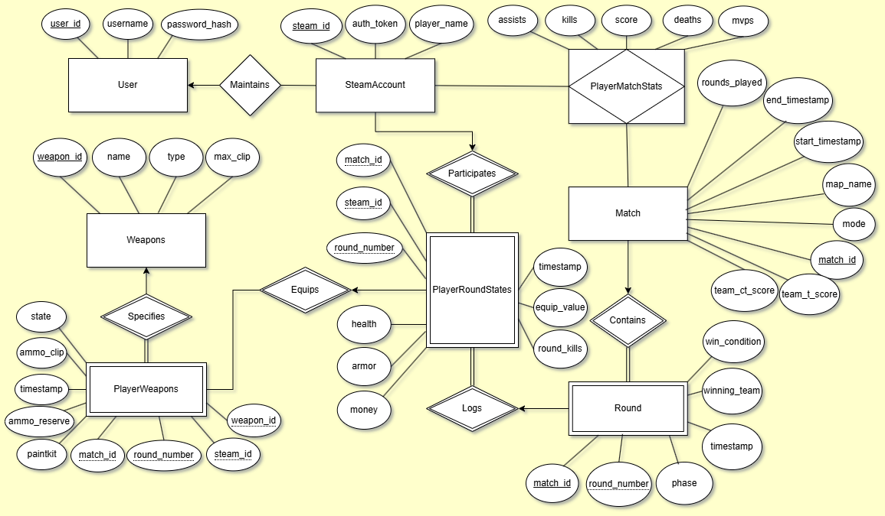
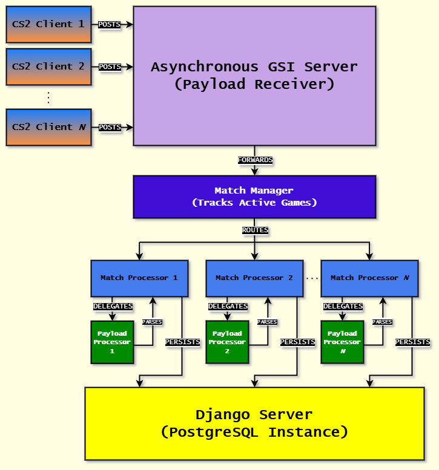

# **The `CounterTrak` Application**

## Table of Contents
- [Introduction](#Introduction)
	- [Motivations](#Motivations)
- [Database Design](#Database-Design)
	- [Entity-Relationship Model](#Entity-Relationship-Model)
	- [Relational Schema Design](#Relational-Schema-Design)
	- [Normalization and Functional Dependencies](#Normalization-and-Functional-Dependencies)
- [Functionality Details](#Functionality-Details)
	- [Basic Database Operations](#Basic-Database-Operations)
	- [Advanced Analytics Functions](#Advanced-Analytics-Functions)
- [Implementation Details](#Implementation-Details)
	- [System Architecture](#System-Architecture)
	- [Technology Stack](#Technology-Stack)
	- [Data Flow and Processing Pipeline](#Data-Flow-and-Processing-Pipeline)
- [Setup, Operations, and Maintenance](#Setup-Operations-and-Maintenance)
	- [Prerequisites](#Prerequisites)
	- [Installation](#Installation)
	- [Database Initialization and Seeding](#Database-Initialization-and-Seeding)
	- [Running the System](#Running-the-System)
	- [GSI Ingestion Pipeline, End-to-End](#GSI-Ingestion-Pipeline-End-to-End)
	- [Operations and Troubleshooting](#Operations-and-Troubleshooting)
- [Experiences and Challenges](#Experiences-and-Challenges)
	- [Technical Challenges](#Technical-Challenges)
	- [Lessons Learned](#Lessons-Learned)
	- [Future Extensions](#Future-Extensions)
- [References](#References)
#### Development Team
1. **Dylan Connolly** (dtc22h@fsu.edu)
2. **Zack Lima** (zol21@fsu.edu)
   
***Repository***: https://github.com/dylantcon/countertrak
## Introduction
The CounterTrak application represents an innovative approach to performance tracking for players of Valve Corporation's popular first-person-shooter Counter Strike 2 (CS2). Developed as a semester-long project for the COP4710 Theory and Structure of Databases course, this web-based informatics system harnesses the power of relational database management systems (RDBMS) to provide players with meaningful insights into their gameplay patterns and performance metrics.

What distinguishes CounterTrak from existing statistics tracking platforms is our focus on lightweight design coupled with sophisticated analytics. While services like HLTV.org and csgostats.gg offer comprehensive but resource-intensive tracking, CounterTrak prioritizes simplicity and accessibility without sacrificing analytical depth. Our application demonstrates that intelligent database design can yield powerful insights without requiring massive computational resources or complex infrastructure.

The system consists of several key components working in concert: an asynchronous HTTP server that receives game state data, a match manager that routes payloads to appropriate processors, a sophisticated database schema optimized for performance analysis, and an intuitive web interface that visualizes player statistics. Together, these components create a seamless pipeline from in-game actions to actionable performance insights, all powered by PostgreSQL and implemented through a Django-based Python backend system.

In the following sections, we detail our database design decisions, functionality implementation, system architecture, and the valuable lessons learned throughout the development process.
### Motivations
The inspiration that sparked the creation of the `CounterTrak` application emanated from the team's appreciation for online gaming, and professional game development. Both Zach and Dylan cultivated an admiration for computers and computing concepts from an early age. These formative circumstances resulted in a natural gravitation towards the gaming community, with online gaming presenting itself as yet another opportunity to engage with the machines they found so captivating. They made many fond memories during these times, and explored the vast range of video-game genres and subgenres. Over time, they began to perceive gaming not just as a mere diversion, but a rich culture that naturally aligned with their systems-oriented cognitive profiles. 

Modern games are immensely complex works of art, born from precise collaborative efforts characteristic of highly seasoned software engineers and computer scientists. The team's discovery of CS2's GSI system presented itself as an opportunity to exercise their collective appreciation for game-development concepts, by applying it towards a data-driven informatics system. The rich dataset facilitated by CS2 GSI was the ideal foundation for a database-powered application. Being highly motivated software developer aspirants, the team members wanted their academic work to be truly distinctive. As a result, `CounterTrak` was born.
## Database Design
The foundation of CounterTrak's functionality lies in its carefully designed database structure. Our database design process began with identifying the key entities in the CS2 gameplay domain and establishing their relationships, followed by translating this conceptual model into a normalized relational schema suitable for implementation in PostgreSQL.
### Entity-Relationship Model
To accurately capture the complex data generated by CS2's Game State Integration system, we developed an entity-relationship model that identifies eight core entities and their interrelationships. This model needed to account for the hierarchical nature of CS2 matches (matches containing rounds, rounds containing player states) while maintaining flexibility for analytical queries.

The entities we identified include:
1. **Users** - CounterTrak account holders who access the application
2. **SteamAccounts** - Steam identities linked to user accounts for authentication
3. **Matches** - Individual CS2 games with metadata such as map, mode, and scores
4. **Rounds** - Discrete gameplay units within matches
5. **PlayerRoundStates** - Player status data during specific rounds
6. **Weapons** - Reference data for all available CS2 weapons
7. **PlayerWeapons** - Relationship entity tracking equipped weapons during gameplay
8. **PlayerMatchStats** - Aggregate performance statistics for players in matches

These entities and their relationships are visualized in the comprehensive ER diagram below:

This diagram illustrates several important design decisions. First, we established a clear separation between user accounts and Steam identities, allowing a single user to track multiple Steam accounts. Second, we implemented a hierarchical structure from matches to rounds to player states, enabling detailed temporal analysis. Third, we created a specialized entity for weapon tracking to support our advanced analytics functions.
### Relational Schema Design
To transform our conceptual ER model into an implementable database design, we developed a detailed relational schema that preserves all entity relationships while optimizing for both data integrity and query performance. The resulting schema consists of eight tables with carefully defined primary and foreign key relationships.
```math
 \begin{aligned}
 &\text{Users}( \underline{steam\_id}, \text{username, password\_hash} ) \\ \\
 &\text{SteamAccounts}(\underline{steam\_id}, \text{user\_id, auth\_token, player\_name} ) \\
 &\exists \quad \text{FK: SteamAccount.user\_id references User}(\underline{user\_id})\\ \\
 &\text{Matches}( \underline{match\_id},\text{mode, map\_name, start\_timestamp, end\_timestamp,}\\ & \qquad \quad \; \text{rounds\_played, team\_ct\_score, team\_t\_score} ) \\ \\
 &\text{Rounds}( \underline{match\_id, round\_number}, \text{phase, timestamp, winning\_team,} \\ & \qquad \quad \; \text{win\_condition}) \\
 &\exists \quad \text{FK: Round.match\_id references Match}(\underline{match\_id}) 
 \end{aligned}
```
```math
\begin{aligned}
 &\text{PlayerRoundStates}( \underline{match\_id, round\_number, steam\_id} \text{, health, armor, } \\
 & \qquad \qquad \qquad \qquad \quad \text{money, equip\_value, round\_kills, state\_timestamp}) \\
 &\exists \quad \text{FK: PlayerRoundStates.(match\_id, round\_number) ref. Round}(\underline{match\_id, round\_number}) \\
 &\exists \quad \text{FK: PlayerRoundStates.steam\_id references SteamAccount}(\underline{steam\_id}) \\ \\
 &\text{Weapons}(\underline{weapon\_id}\text{, name, type, max\_clip}) \\ \\
 &\text{PlayerWeapons}(\underline{match\_id, round\_number, steam\_id, weapon\_id}\text{, state, ammo\_clip, state\_timestamp} \\
 & \qquad \qquad \qquad \quad \text{ammo\_reserve, paintkit}) \\
 &\exists \quad \text{FK: PlayerWeapons.(match\_id, round\_number, steam\_id) references} \\
 & \qquad \quad \; \; \text{PlayerRoundStates}(\underline{match\_id, round\_number, steam\_id}) \\
 &\exists \quad \text{FK: PlayerWeapons.weapon\_id references Weapons}(\underline{weapon\_id}) \\ \\
 &\text{PlayerMatchStats}(\underline{steam\_id, match\_id}\text{, kills, deaths, assists, mvps, score}) \\
 &\exists \quad \text{FK: PlayerMatchStats.steam\_id references SteamAccount}(\underline{steam\_id}) \\
 &\exists \quad \text{FK: PlayerMatchStats.match\_id references Match}(\underline{match\_id})
\end{aligned}
```
This schema includes several noteworthy features. We implemented composite primary keys in the Rounds, PlayerRoundStates, and PlayerWeapons tables to efficiently represent hierarchical relationships. The temporal aspect of game state tracking is captured through timestamps in appropriate tables, enabling precise sequence analysis. Additionally, we created a pre-populated Weapons table to serve as a reference for all in-game weapons, improving both performance and data consistency.
### Normalization and Functional Dependencies
Our schema design adheres to Boyce-Codd Normal Form (BCNF), ensuring efficient data storage and minimizing anomalies. We identified and addressed the following functional dependencies:
1. In the **Users** table, `user_id` functionally determines `username` and `password_hash`
2. In the **SteamAccounts** table, `steam_id` functionally determines `user_id`, `auth_token`, and `player_name`
3. In the **Matches** table, `match_id` functionally determines all match attributes
4. In the **Rounds** table, the composite key `(match_id, round_number)` functionally determines round attributes
5. In the **PlayerRoundStates** table, the composite key `(match_id, round_number, steam_id)` functionally determines player state attributes
6. In the **Weapons** table, `weapon_id` functionally determines weapon attributes, with `name` as an alternative candidate key
7. In the **PlayerWeapons** table, the composite key `(match_id, round_number, steam_id, weapon_id)` functionally determines weapon state attributes
8. In the **PlayerMatchStats** table, the composite key `(steam_id, match_id)` functionally determines all player match statistics

This normalization approach provided several advantages for our application. It minimized data redundancy, reducing storage requirements for the potentially large volume of game state data. It eliminated update anomalies that could compromise data integrity during high-frequency state changes. Most importantly, it created a schema structure that naturally supported our advanced temporal sequence analysis for player performance patterns.

The schema also includes several integrity constraints beyond normal foreign key relationships. We implemented check constraints on valid value ranges for attributes like health, armor, and money. We created triggers to automatically update match scores when rounds are completed. Additionally, we developed custom validation logic in our Django models to ensure that incoming GSI data conforms to expected patterns before being committed to the database.

This comprehensive database design forms the foundation for CounterTrak's functionality, enabling both efficient storage of game state data and sophisticated analytical queries that reveal meaningful patterns in player performance.
## Functionality Details
### Basic Database Operations
CounterTrak implements a comprehensive set of database operations to manage game state data efficiently, focusing on the CRUD (Create, Read, Update, Delete) paradigm while handling the complexity of hierarchical and temporal relationships in our data model.

The record creation process is carefully orchestrated to maintain referential integrity across related entities. When a new match begins, the system creates a match record with initial state data, followed by round records and player state records as the match progresses. This insertion logic is particularly complex as it must handle transactional consistency across multiple related tables.

For example, when a new player action is detected through the GSI system, our application executes a series of interdependent database operations:
```sql
INSERT INTO stats_playerroundstate
(match_id, round_number, steam_account_id, health, armor,
 money, equip_value, round_kills, team, state_timestamp)
VALUES (%s, %s, %s, %s, %s, %s, %s, %s, %s, %s)
RETURNING id
```
Within the `CounterTrak` system, record retrieval operations from a basic perspective center around duplicate record checks during match data ingress. Here is an example of a check for duplicate PlayerRoundState records, within `backend/gsi/django_integration.py`:
```python
# ...
state_time = convert_unix_timestamp_to_datetime(player_state.state_timestamp)
with connection.cursor() as cursor:
	cursor.execute(
		"""
		SELECT COUNT(*) FROM stats_playerroundstate
		WHERE
			match_id = %s AND
			round_number = %s AND
			steam_account_id = %s AND
			state_timestamp = %s
		""",
		[
			match_id,
			round_number,
			player_state.steam_id,
			state_time
		]
	)
	return cursor.fetchone()[0] > 0
# ...
```
Updates are handled carefully to ensure data integrity, particularly for player statistics that change frequently during a match. The system uses atomic updates to modify specific fields without affecting unrelated data:
```sql
UPDATE stats_playermatchstat
SET 
    kills = EXCLUDED.kills,
    deaths = EXCLUDED.deaths,
    assists = EXCLUDED.assists,
    mvps = EXCLUDED.mvps,
    score = EXCLUDED.score
```
For data deletion, we implemented cascading delete operations that maintain referential integrity while efficiently removing all related records. This is particularly important for match deletion, which must clean up all associated round, player state, and weapon records:
```sql
DELETE FROM stats_playerweapon WHERE match_id = %s;
DELETE FROM stats_playerroundstate WHERE match_id = %s;
DELETE FROM stats_playermatchstat WHERE match_id = %s;
DELETE FROM matches_round WHERE match_id = %s;
DELETE FROM matches_match WHERE match_id = %s;
```
These basic operations form the foundation upon which our advanced analytical features are built, ensuring data integrity and performance even under high-volume data processing conditions.
### Advanced Analytics Functions
CounterTrak treats "advanced analytics" as everything beyond single-table aggregation: multi-table, temporal analysis that turns the raw snapshot stream into actionable, per-player insight. These analytics reach the user through two surfaces. The first is the **SQL Query Explorer** (`/stats/query-explorer/`), a library of parameterized analytical queries grouped into Basic and Advanced categories that run read-only against the logged-in player's Steam ID. The second is the **Advanced Weapon Analysis** page (`/stats/weapon-analysis/`), which renders gun, grenade, and economic breakdowns produced by a Python kill-attribution engine.

#### The snapshot-collapse principle

Every analytical query in CounterTrak rests on one rule imposed by the data model. The `stats_playerroundstate` and `stats_playerweapon` tables hold **one row per GSI payload** (up to roughly ten per second), and each of those snapshot rows carries the same running `round_kills` counter for the round. Summing `round_kills` across these snapshots, or across a JOIN that multiplies them, inflates kill counts by an order of magnitude. The correct pattern, used throughout the current query set, collapses each round to a single value with `MAX(round_kills)` (the counter is monotonic within a round, so its maximum is the round total) before aggregating. Because a player may hold several weapons in a round, that round's kills are then split evenly across its distinct active weapons, so the estimated kills sum back to the true round total.

#### Weapon effectiveness analysis

The weapon effectiveness queries (`sql/weapon_performance.sql`, and the tiered recommender in `sql/advanced/weapon_recommendations.sql`) apply this collapse directly. The CTE chain builds one round-total per round, counts the active weapons in that round, and divides:

```sql
WITH rk AS (                         -- one row per (match, round): the round's kill total
    SELECT match_id, round_number, steam_account_id,
           MAX(round_kills) AS round_kills
    FROM stats_playerroundstate
    WHERE steam_account_id = ${steam_id}
    GROUP BY match_id, round_number, steam_account_id
),
aw AS (                              -- distinct weapons that were active that round
    SELECT DISTINCT match_id, round_number, steam_account_id, weapon_id
    FROM stats_playerweapon
    WHERE state = 'active' AND steam_account_id = ${steam_id}
),
awc AS (                             -- how many active weapons share the round's kills
    SELECT match_id, round_number, steam_account_id, COUNT(*) AS active_weapons
    FROM aw GROUP BY match_id, round_number, steam_account_id
),
attr AS (                            -- even split: round_kills / active_weapons per weapon
    SELECT aw.weapon_id, aw.match_id, aw.round_number,
           rk.round_kills::numeric / NULLIF(awc.active_weapons, 0) AS est_kills
    FROM aw
    JOIN awc USING (match_id, round_number, steam_account_id)
    JOIN rk  USING (match_id, round_number, steam_account_id)
)
SELECT w.name AS weapon_name, w.type AS weapon_type,
       COUNT(DISTINCT attr.match_id)                  AS times_used,
       ROUND(SUM(attr.est_kills), 0)                  AS total_kills_with_weapon,
       ROUND(SUM(attr.est_kills)::numeric /
             NULLIF(COUNT(DISTINCT (attr.match_id, attr.round_number)), 0), 2) AS kills_per_round
FROM attr
JOIN stats_weapon w ON w.weapon_id = attr.weapon_id
GROUP BY w.name, w.type
ORDER BY total_kills_with_weapon DESC;
```

The advanced recommender extends this per map and folds three normalized factors, namely kills per round, kill consistency (the share of rounds with at least one kill), and economic efficiency (kills per $1000 spent), into a weighted `weapon_effectiveness_score` and an S/A/B/C/D recommendation tier. The result tells a player which weapons to favor on which map.

#### Economic impact analysis

The economic queries (`sql/economic_analysis.sql`) bucket each round into Eco, Semi-Eco, Semi-Buy, or Full-Buy by average equipment value, then report win rate, average kills, and kills per $1000 for each bucket. Win rate is computed honestly, by comparing the round winner against the player's own team (`r.winning_team = rk.team`) rather than assuming every decided round was a win. A companion query uses the `LAG()` window function over the round sequence to measure economic momentum: how the previous round's buy level and its win or loss shift the current round's investment and outcome.

#### Player-versus-field comparative analytics

A newer family of queries answers "how do I compare?" rather than "how did I do?". All three build on `stats_playermatchstat`, which holds one authoritative, upserted row per player per match and therefore sidesteps snapshot inflation entirely:

- `compare_percentile_ranking.sql` ranks the player against every other tracked player on kills, K/D, assists, MVPs, and score using `PERCENT_RANK()`.
- `compare_map_edge.sql` surfaces the maps where the player's per-match output most exceeds the average of all other players on that same map.
- `compare_playstyle_signature.sql` characterizes how a player plays through role ratios (support, impact, utility, dueling, firepower) and each ratio's deviation from the field average.

The percentile query captures the shape of all three: aggregate per player, rank with a window function, then compare the target against the field.

```sql
WITH player_agg AS (
    SELECT steam_account_id,
           AVG(kills)                                   AS avg_kills,
           SUM(kills)::numeric / NULLIF(SUM(deaths), 0) AS kd_ratio
           -- ... assists, mvps, score elided ...
    FROM stats_playermatchstat
    GROUP BY steam_account_id
),
ranked AS (
    SELECT steam_account_id, avg_kills, kd_ratio,
           PERCENT_RANK() OVER (ORDER BY avg_kills) AS pr_kills,
           PERCENT_RANK() OVER (ORDER BY kd_ratio)  AS pr_kd
    FROM player_agg
)
SELECT 'Kills / match' AS metric,
       ROUND(me.avg_kills, 2)                  AS your_value,
       ROUND((me.pr_kills * 100)::numeric, 1)  AS percentile_rank
FROM ranked me
WHERE me.steam_account_id = ${steam_id};
```

#### Kill attribution engine

The Advanced Weapon Analysis page is powered by a shared **kill-attribution engine** (`apps/stats/utils/kill_attribution.py`). Because the GSI feed has no killfeed, the engine infers every weapon-level kill from state deltas across the snapshot stream. For each rise in `round_kills` it attributes the kill, in priority order, to one source: the active firearm if its `ammo_clip` dropped at that snapshot, meaning a shot was fired (high confidence); otherwise a lethal grenade (HE, incendiary, or molotov) if one was thrown within its fuse or burn window (high confidence on a multi-kill tick, medium otherwise); otherwise the active firearm as a low-confidence fallback. Knife kills and kills with no supporting evidence are left unattributed rather than guessed. Both the gun and grenade reports run off this single pass, so each kill is credited exactly once and never double-counted between them. The engine's main limitation is the whole-second snapshot resolution: actions that collapse into the same second cannot be ordered, so recovering the true per-kill weapon in those cases would require parsing match demo (`.dem`) files.

Two analyzers consume the engine. `weapon_analyzer.py` (`get_weapon_analysis`) reports, per firearm, rounds used, times active, attributed kills, average kills when active, and average money, excluding grenade-attributed kills so the gun and grenade tables never overlap. `grenade_analyzer.py` (`get_grenade_analysis`) reports, per grenade type, the exactly-tracked throw count alongside inferred kill estimates and kills per throw, which the page renders as its Grenade Impact table.

#### Performance pattern recognition (experimental)

The repository also contains a Performance Pattern Recognition engine (`gsi/performance_pattern_recognition.py`) that composes weapon-effectiveness, economic, and (currently stubbed) weapon-sequence analyses into natural-language insights and recommendations. It is an aspirational module rather than a shipped feature: it is not yet wired into any view or template, and it predates the snapshot-collapse refactor described above. It is best read as a prototype for future work, not a description of current behavior.

## Implementation Details
CounterTrak employs a multi-tier, event-driven architecture designed to efficiently process game state data in real-time while maintaining data consistency and system responsiveness. The architecture consists of several key components, each with specific responsibilities in the data flow pipeline. The high-level architecture is illustrated in the diagram below:


At the top level, the **Asynchronous GSI Server** component (implemented in `backend/gsi/async_server.py`) receives game state payloads from multiple CS2 clients simultaneously. This component uses Python's `asyncio` framework to provide non-blocking I/O, allowing it to handle many concurrent connections efficiently without creating a thread per connection. The server authenticates incoming payloads using token validation and routes them to the appropriate match processor.

The **Match/Player Manager** component (`backend/gsi/match_manager.py`) serves as a central coordination point, tracking active matches and creating new match processors as needed. This component maintains a dictionary of active match processors keyed by match ID, ensuring that each match's data remains isolated and consistent. The manager is primarily responsible for routing payloads to their appropriate `MatchProcessors`, but does perform some basic preliminary validation to ensure that the data hails from a new or in-progress match.

Individual **Match Processors** (`backend/gsi/match_processor.py`) handle the game state for specific matches, maintaining state between updates and managing the temporal sequence of events. Each processor operates independently, parsing game events using a delegate object called `PayloadExtractor`, tracking round transitions, and persisting data at appropriate points (typically at round boundaries). This isolation ensures that data from one match cannot interfere with another, while also enabling parallel processing of multiple matches.

At the bottom tier, the **Async Database Connection Pool** provides efficient, non-blocking database access. This component manages connections to the PostgreSQL database, using asyncio-compatible database drivers to perform database operations without blocking the event loop. All `INSERT` and `UPDATE` operations are handled in `gsi/backend/django_integration.py`, with calls being made from any instantiated `MatchProcessor`s. The connection pool ensures that database operations are properly sequenced and transactionally consistent.

This architecture provides several key advantages:
1. **Scalability**: The system can handle many concurrent matches without proportional resource consumption, as the async I/O model is much more efficient than traditional threading.
2. **Fault Isolation**: Problems in one match processor don't affect others, improving system resilience.
3. **Data Consistency**: By processing each match independently and using appropriate transaction boundaries (typically round completion), the system ensures data is consistently persisted.
4. **Performance**: The non-blocking I/O model keeps the system responsive even under heavy load, as it can process other requests while waiting for I/O operations to complete.

The architecture also includes a separate **Django Web Application** that provides the user interface and REST API for accessing match statistics and analysis results. This component operates independently from the GSI processing pipeline, accessing the same database but focusing on query operations rather than data ingestion.
### Technology Stack
The CounterTrak application is built on a modern, scalable technology stack designed to efficiently handle real-time game data processing, storage, and analysis:
1. **Database Layer**:
    - **PostgreSQL 14**: Primary RDBMS providing robust data storage, complex querying capabilities, and transaction support.
    - **Database Schema**: Carefully normalized to BCNF with optimized indexes for query performance.
    - **Connection Pooling**: Implemented through Django's connection pool for efficient database access.
2. **Backend Processing**:
    - **Python 3.10+**: Core programming language for backend development.
    - **Django 5.2**: Web framework providing ORM, authentication, and routing capabilities.
    - **Django REST Framework 3.16**: For building the REST API endpoints.
    - **asyncio**: Python's asynchronous I/O framework, used for non-blocking operations.
    - **aiohttp 3.11+**: Asynchronous HTTP client/server for Python, used for the GSI server.
3. **Frontend**:
    - **HTML5/CSS3/JavaScript**: Standard web technologies for UI development.
    - **Bootstrap 5.3**: Frontend CSS framework for responsive design.
4. **Development & DevOps**:
	- **Git**: Version control system for code management.
	- **GitHub**: Repository hosting.
	- **dotenv**: Environment variable management for secure configuration.
	- **pexpect**: Used for automation in development scripts.

Our technology choices reflect a focus on scalability, maintainability, and performance. The use of asynchronous processing with `asyncio` and `aiohttp` is particularly notable, as it allows our system to handle many concurrent game clients efficiently without the overhead of traditional threading models.
### Data Flow and Processing Pipeline
The CounterTrak data flow pipeline is designed to efficiently process game state information from raw GSI payloads to structured database records and ultimately to meaningful analytical insights. This pipeline consists of several key stages:
1. **Payload Reception and Authentication**:
    - CS2 clients send HTTP POST requests containing GSI payloads to the async server.
    - The server authenticates payloads using the auth token from the request.
    - This stage is implemented in `backend/gsi/async_server.py`.
2. **Payload Routing and Match Association**:
    - The match manager extracts the match identifier from the payload.
    - If this is a new match, a new match processor is created.
    - The payload is routed to the appropriate match processor.
    - This stage is implemented in `backend/gsi/match_manager.py`.
3. **Game State Extraction and Normalization**:
    - The `PayloadExtractor` class (in `backend/gsi/payloadextractor.py`) parses the raw JSON payload.
    - The extractor creates structured data objects for match state, player state, round state, and weapon states.
    - These structured objects map to database tables in the relational schema, an example for the Match table is seen below:
```python
def extract_match_state(self, payload: Dict, timestamp: int) -> Optional[MatchState]:
    if 'map' not in payload or 'provider' not in payload:
        return None
    map_data = payload['map']
    provider_data = payload['provider']
    # use centralized utility function to get base_match_id
    base_match_id = extract_base_match_id(payload)
    if not base_match_id:
        return None
    # get raw round number from map payload portion
    raw_round = map_data.get('round', 0)
    # add 1 to convert from zero-indexed to one-indexed
    adjusted_round = raw_round + 1
    # return full match state with the provided timestamp
    return MatchState(
        match_id=base_match_id,
        mode=map_data.get('mode', 'casual'),
        map_name=map_data.get('name', 'unknown_map'),
        phase=map_data.get('phase', 'unknown'),
        round=adjusted_round,
        team_ct_score=map_data.get('team_ct', {}).get('score', 0),
        team_t_score=map_data.get('team_t', {}).get('score', 0),
        timestamp=timestamp
    )
```
The multi-tier architecture and data flow pipeline of CounterTrak demonstrate a sophisticated approach to real-time game data processing. By implementing asynchronous I/O throughout the system, we've created a solution that efficiently handles the high-volume, bursty nature of GSI data while maintaining responsiveness. The well-defined responsibility boundaries between components (GSI server, match processors, database layer) provide clear separation of concerns, making the system both maintainable and extensible. This architecture not only meets the requirements of our current implementation but also establishes a solid foundation for future enhancements, such as more advanced analytics algorithms or integration with additional data sources.
## Setup, Operations, and Maintenance
This section is the practical companion to the architectural discussion above. It documents how to stand up CounterTrak from a clean checkout, how game data flows through the ingestion pipeline at the level of individual function calls, and how to diagnose the failure modes we have actually encountered in operation. Where the earlier sections explain *what* the system is and *why* it is designed that way, this section explains *how* to run, seed, and maintain it.

The repository is laid out with a Python virtual environment at the project root (`venv/`) and the Django project under `backend/`. Unless noted otherwise, every command below is run from the `backend/` directory with the virtual environment active.

### Prerequisites
- **PostgreSQL 14+**, with a database and role matching the credentials you will place in `.env`.
- **Python 3.10+** with the ability to create virtual environments.
- The CS2 client that will feed the system, configured with a Game State Integration config file. A working example lives at the repository root as `gamestate_integration_GSI.cfg`; it is installed into the game's `csgo/cfg/` directory and points the client at the GSI server's `host:port` with a matching `auth` token.

### Installation
```bash
# from the repository root
python -m venv venv
source venv/bin/activate
pip install -r requirements.txt          # Django 5.2, DRF, aiohttp, colorlog, pexpect, python-dotenv, psycopg

# configure environment
cp backend/.env.example backend/.env      # then edit DB_*, SECRET_KEY, GSI_HOST/PORT, STEAM_API_KEY
```
The `.env` file is the single source of configuration for both servers; `backend/.env.example` enumerates every variable that is read. In the deployed environment `.env` is owned `root:www-data` with mode `0640`, so management commands and ad-hoc database scripts must be run **as the `www-data` user** (for example `sudo -u www-data ...`) - running them as your own user will fail to read the file and therefore fail to connect to the database.

### Database Initialization and Seeding
Bringing up a fresh database is a single command:
```bash
# from backend/, with the venv active
python manage.py migrate     # creates the schema AND seeds reference data
```
`migrate` applies the schema migrations and then runs the data migration `0008_seed_weapons`, which populates the `stats_weapon` reference table with all 45 CS2 weapons (`weapon_id`, `name`, `type`, `max_clip`). The seed is an idempotent upsert, so it is safe to re-run and never duplicates rows. Because the ingestion pipeline resolves every weapon by name against this table, seeding it is part of schema setup rather than a separate step you have to remember.

The canonical weapon list lives in `backend/apps/stats/weapon_data.py` and is the single source of truth shared by the migration and the `load_weapons` management command. `load_weapons` remains available for **manual re-seeding** - most usefully after a bare `manage.py flush`, which empties tables without re-running migrations:
```bash
python manage.py load_weapons   # manual re-seed; prints "... 45 weapons (EXPECTED: 45)"
```
To reset the database completely, `backend/wipeall.py` drops and recreates the `public` schema and re-runs `migrate` (which re-seeds automatically). Run it from `backend/`.

### Running the System
CounterTrak is two cooperating servers: the asynchronous GSI ingestion server (`backend/gsi/async_server.py`, default port `3000`) and the Django web/API server (`manage.py runserver`, port `8000`). Both are blocking event loops, so `backend/run_servers.py` launches each in its own subprocess and multiplexes their output to a common stream.

- **Development:** `python backend/run_servers.py` from the repository root (with the venv active) starts both servers and tears them down cleanly on exit.
- **Production:** the system runs under systemd as `countertrak.service` (`User=www-data`, `WorkingDirectory=` the repository root, `ExecStart=` the venv Python running `run_servers.py`). Manage it with the usual unit commands:
```bash
sudo systemctl restart countertrak.service   # apply changes to GSI Python code
sudo systemctl status  countertrak.service
sudo journalctl -u countertrak.service -f
```
A restart is required after editing any of the long-lived GSI modules (`async_server`, `match_manager`, `match_processor`, `payloadextractor`, `django_integration`), since those run inside the persistent process. It is **not** required after re-seeding reference data such as the Weapon table.

### GSI Ingestion Pipeline, End-to-End
The following traces a single weapon observation from the CS2 client to a persisted `stats_playerweapon` row, naming the function at each hop. This is the path to follow when weapon, kill, or round data is missing.

1. **Reception & authentication** - `gsi/async_server.py::GSIServer.handle_gsi_payload`. The CS2 client `POST`s a JSON payload to `/`. The handler parses it and calls `_authenticate_payload`, which validates `payload["auth"]["token"]` against the in-memory `TokenCache` (backed by `accounts_steamaccount.auth_token`, refreshed every 10 minutes). An unknown token yields `401` and the payload is discarded; a valid one is forwarded to `match_manager.route_payload`.
2. **Routing** - `gsi/match_manager.py::MatchManager.route_payload`. A stable `base_match_id` is derived from `provider.steamid` + map + mode (`gsi/utils.py::extract_base_match_id`). Menu payloads and payloads missing `provider.steamid`/`player.steamid` are dropped here. `_get_or_create_processor` then returns the existing `MatchProcessor` for that base id, resumes a still-open match (`find_open_match`, to survive a mid-match restart), or mints a new one - but only after `ensure_steam_account` confirms the client owner is a registered Steam account.
3. **Extraction** - `gsi/payloadextractor.py::PayloadExtractor`. `extract_all_weapons` walks `player.weapons` and builds a `{slot: WeaponState}` dictionary, tagging each `WeaponState` with the `player.steamid` it belongs to; sibling methods extract the match, round, and player states. The extractor deliberately decouples raw GSI JSON from the database models.
4. **Accumulation** - `gsi/match_processor.py::MatchProcessor`. Because the database stores **one row per snapshot**, the processor appends each payload's weapon dictionary to `weapon_states_history` (and player states to `player_states_history`) rather than writing immediately. Persistence is deferred to a round boundary, guarded by `persistence_lock` and the `rounds_persisted` set so a round is written exactly once.
5. **Persistence** - `gsi/match_processor.py::_persist_round_data` -> `gsi/django_integration.py::batch_create_player_weapons` -> `create_player_weapon_states`. For each accumulated weapon, the name is resolved to a `weapon_id` via a cached lookup (`_lookup_weapon_id`, backed by the seeded reference table), and the row is inserted with `INSERT ... ON CONFLICT (match_id, round_number, steam_account_id, weapon_id, state_timestamp) DO NOTHING`. The temporal unique constraint makes re-persistence idempotent, which is what lets a resumed match safely re-process rounds.

The single most important property to internalize is from step 4: **one database row per GSI payload**. Counters such as `round_kills` are cumulative per snapshot, so any analytical query must take `MAX(round_kills)` per `(match, round, player)` rather than `SUM` - summing across snapshots, or across a join that multiplies snapshot rows, produces large-scale kill inflation.

### Operations and Troubleshooting
- **Logs.** Both servers log to `backend/countertrak.log` (and to stdout, captured by `journalctl` under systemd). The log lines are colorized with ANSI escape codes that are also written into the file, so view it with `less -R countertrak.log` and strip the codes (`sed 's/\x1b\[[0-9;]*m//g'`) before feeding it to tools that expect plain text.
- **Symptom: `Unknown weapon` / `Created 0 weapon states`.** The `stats_weapon` table is empty or missing entries. Verify with a shell one-liner (`Weapon.objects.count()` should be `45`) and re-run `python manage.py load_weapons`. See [Database Initialization and Seeding](#Database-Initialization-and-Seeding).
- **Symptom: the GSI server exits at startup before binding port 3000.** The logging subsystem opens `countertrak.log` eagerly at import time using a path relative to the working directory; if the `www-data` service user cannot write that file, the import raises and the process dies before it ever listens. Ensure `backend/countertrak.log` exists and is writable by `www-data`.
- **Running database/management commands.** Always invoke them as the database-capable user, e.g. `sudo -u www-data /var/www/countertrak.dconn.dev/venv/bin/python manage.py <command>`, so that the `0640` `.env` is readable.
## Experiences and Challenges
### Technical Challenges
Throughout the development of CounterTrak, our team encountered and overcame several significant technical challenges:
1. **Multiprocess Dual-Server Architecture**: Given our choice of PostgreSQL with the Django backend framework, we were forced to reconcile with how we would integrate our original Game State Integration server with proper database persistence. We realized that the GSI Server needed to listen for incoming payloads within a main loop (`python async_server.py`), and Django required its own main loop (`python manage.py runserver 0.0.0.0:8000`) for communication with the PSQL instance—both were blocking processes. To overcome this, we decided to implement a dual-server approach in `backend/run_servers.py`, which compartmentalized each server's main loop within its own `subprocess`. To consolidate the disparate output streams to a common destination, we maintained two separate threads for the servers, each of which piped their output to standard output via the method `stream_output(process, prefix)`. Each call then iteratively logged the output from the two threads using `for line in iter(process.stdout.readline):`, `if line:`, `print(f"[{prefix}] {line}", end="", flush=True)`, with proper `try-except` handling for `IOError`(s) and `ValueError`(s). Additionally, we implemented intelligent thread and subprocess cleanup, to ensure that no child threads or subprocesses were left hanging after server shutdown.
2. **Asynchronous Processing Complexity**: Implementing a fully asynchronous system using Python's asyncio library required a substantial paradigm shift in our programming approach. We needed to carefully manage concurrency, especially in the match processor components where race conditions could lead to data inconsistencies. This was addressed through strategic use of locks (`asyncio.Lock`) and careful transaction management.
3. **Temporal Sequence Analysis**: One of our most complex challenges was implementing accurate temporal relationship analysis for weapon effectiveness. Unlike simpler statistics systems that only count kills, we needed to determine which weapon was active at the exact moment a kill occurred. This required sophisticated SQL queries using window functions and temporal joins:
```sql
WITH PlayerStateChanges AS (
    SELECT 
        prs1.match_id, 
        prs1.round_number,
        prs1.state_timestamp,
        prs1.round_kills - LAG(prs1.round_kills, 1, 0) OVER (
            PARTITION BY prs1.match_id, prs1.round_number 
            ORDER BY prs1.state_timestamp
        ) AS kill_increase
    FROM stats_playerroundstate prs1
    WHERE 
        prs1.steam_account_id = %s
        AND prs1.round_kills > 0
),
ActiveWeapons AS (
    -- Track active weapons at each timestamp
    -- ...
)
```
3. **Database Performance Optimization**: Managing the potentially high volume of GSI payloads required careful database design. We implemented several optimizations:
    - Strategic denormalization for frequently accessed data
    - Composite indexes for common query patterns
    - Batch processing of state updates to reduce database load
4. **Authentication and Security**: Ensuring that only authorized clients could submit game state data required a token-based authentication system. We implemented a token cache with periodic refreshing to maintain security while minimizing database queries.
### Lessons Learned
The CounterTrak project provided numerous valuable insights that have enhanced our understanding of both technical and project management aspects:
1. **Asynchronous Design Benefits**: The decision to use an asynchronous architecture with Python's asyncio framework proved extremely beneficial. It allowed our system to handle many concurrent connections with minimal resource consumption, making the application scalable without proportional resource requirements. This approach is significantly more efficient than traditional multi-threading for I/O-bound operations like our GSI server.
2. **Importance of Domain Modeling**: Starting with a carefully designed entity-relationship model before implementing database schemas was crucial. The time invested in proper domain modeling paid dividends throughout the project by providing a clear conceptual framework that guided implementation decisions.
3. **Data Structure Separation**: Maintaining clear separation between raw payload data structures and database models prevented data format changes in the GSI system from directly affecting our database schema. This abstraction layer, implemented through our `PayloadExtractor` class, provided important flexibility.
4. **Progressive Enhancement**: Building the system incrementally - first focusing on correct data capture, then basic statistics, and finally advanced analytics - allowed us to deliver value at each stage while continuing to enhance functionality.
5. **Centralized Logging**: Implementing a comprehensive logging system early in development proved invaluable for debugging complex asynchronous behaviors and monitoring system performance.
### Future Extensions
Looking forward, we envision several promising directions for extending CounterTrak:
1. **Advanced Pattern Recognition**: The current Performance Pattern Recognition engine could be enhanced with machine learning algorithms (using `pytorch` or `tensorflow`) to identify more complex patterns in player behavior and provide more personalized recommendations.
2. **Comparative Analytics**: Implementing functionality to compare player performance against population averages or professional player benchmarks would provide additional context for performance evaluation.
3. **Real-time Feedback System**: Developing a system to provide real-time feedback during matches could help players adjust their strategies on-the-fly based on historical performance data.
4. **API Expansion**: Creating a more comprehensive API would enable third-party developers to build additional tools and visualizations using CounterTrak's data and analytics engine.
---
## References
1. Django Project. (2025). _Django Documentation_. [https://docs.djangoproject.com/en/5.2/](https://docs.djangoproject.com/en/5.2/)
2. Python Software Foundation. (2025). _asyncio — Asynchronous I/O_. [https://docs.python.org/3.10/library/asyncio.html](https://docs.python.org/3.10/library/asyncio.html)
3. aiohttp. (2025). _aiohttp Documentation_. [https://docs.aiohttp.org/en/stable/](https://docs.aiohttp.org/en/stable/)
4. Valve Corporation. (2024). _Counter-Strike: Global Offensive Game State Integration_. [https://developer.valvesoftware.com/wiki/Counter-Strike:_Global_Offensive_Game_State_Integration](https://developer.valvesoftware.com/wiki/Counter-Strike:_Global_Offensive_Game_State_Integration)
5. Plotnikov, A. (2024). _Development of an esports HUD for Counter-Strike 2_. Bachelor's thesis, Esports Business.
6. PostgreSQL Global Development Group. (2025). _PostgreSQL Documentation_. [https://www.postgresql.org/docs/14/](https://www.postgresql.org/docs/14/)
7. The Python Package Index (PyPI). (2025). _colorlog 6.9.0_. [https://pypi.org/project/colorlog/](https://pypi.org/project/colorlog/)
8. Django REST Framework. (2025). _Django REST Framework Documentation_. [https://www.django-rest-framework.org/](https://www.django-rest-framework.org/)
